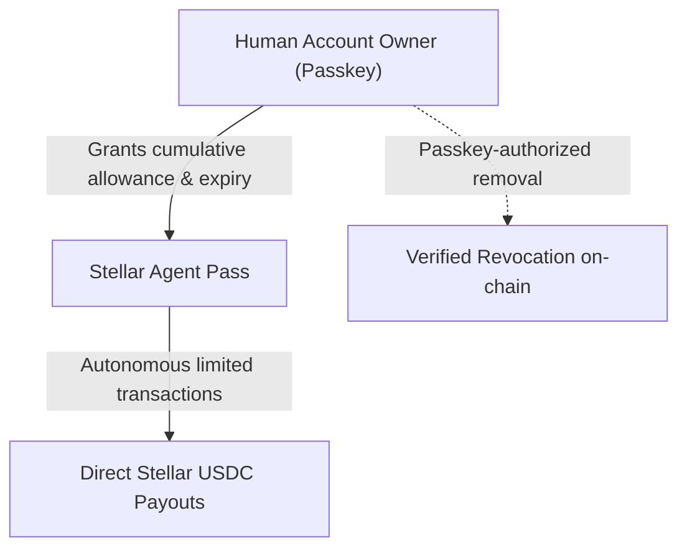

# Page Override: Agent Pass Management (Stellar Smart Account)

> **Inspiration Source**: **Talise** (`talise.io` - on-chain Agent Passes & MCP allowances) + **Family** (card elegance & status pills) + **Linear** (action speed & revocation safety).

---

## 1. Talise-Inspired Agent Pass Concept for Stellar

Talise showed the power of native on-chain allowances for AI assistants (via MCP). In Telya:
- **Architecture**: Powered by **Stellar Smart Account Kit** (Soroban smart contract rules).
- **Scope (Buildathon P0)**: Direct Stellar USDC spending only.
- **Non-Negotiable Rule**: The human user is the root owner via passkey. The owner creates or revokes the bounded permission on-chain. Changing a pass means revoking it and creating a replacement; P0 does not edit an active rule in place.



---

## 2. Agent Pass Visual Card

Styled like a sleek, digital executive pass or metallic allowance card:

### Card Visual Elements
1. **Pass Chip & Header**:
   - Agent Name: e.g. `"Perplexity Research Bot"` or `"Freelance Subscription Agent"`
   - Active Status Pill: Navy/blue dot + `"Active"` (or Amber `"Near Limit"` / Red `"Revoked"`). Proof emerald remains reserved for verified settlement.
   - Network Pill: `"Stellar Smart Account"`
2. **Spending Allowance Meter**:
   - Progress bar displaying verified spend vs cumulative allowance:
     ```
     Spent: 14.50 USDC of 50.00 USDC cumulative allowance
     [████████░░░░░░░░░░░░░░░░░░░░] 29%
     ```
3. **Safety Constraints**:
   - Scope: configured direct Stellar USDC contract only.
   - Cumulative allowance: `50.00 USDC` for the life of this pass.
   - Valid until: the on-chain expiration ledger, with an approximate time only when derived from current ledger data.
4. **Instant Action Controls**:
   - Primary: **"Revoke Pass"** (Red tint button with shield/cancel SVG).
   - A replacement limit requires revoking this pass and creating another owner-authorized pass.

---

## 3. Revocation Confirmation Modal (Linear-Style Safety)

When the user taps "Revoke Pass":
- Modal dialog confirms:
  - *"Confirm revocation with your passkey. The agent remains active until Stellar verifies removal of this rule."*
- Action buttons:
  - **"Revoke Immediately"** (Danger red)
  - **"Keep Active"** (Muted neutral)
- Post-revocation state:
  - Only after on-chain verification, the card transitions to a disabled, greyed-out state with stamp: `"REVOKED"`.
