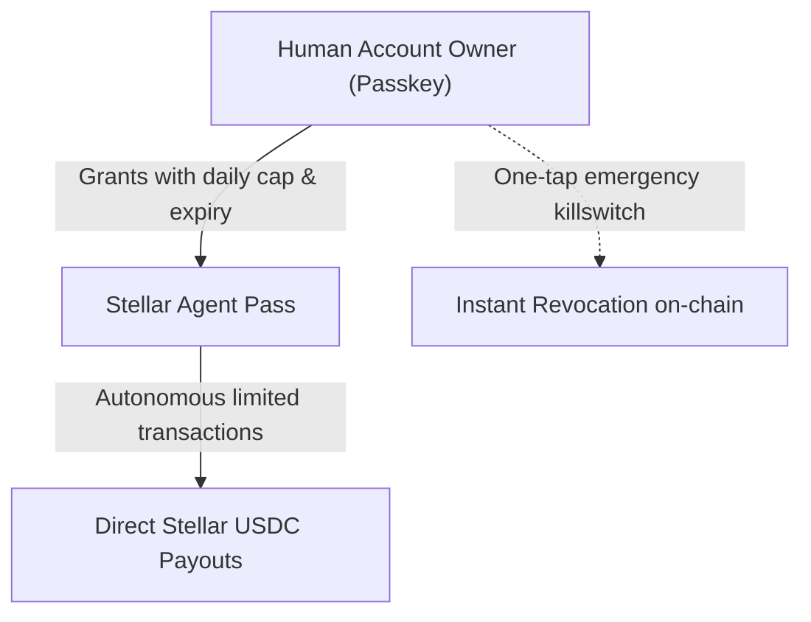

# Page Override: Agent Pass Management (Stellar Smart Account)

> **Inspiration Source**: **Talise** (`talise.io` - on-chain Agent Passes & MCP allowances) + **Family** (card elegance & status pills) + **Linear** (action speed & revocation safety).

---

## 1. Talise-Inspired Agent Pass Concept for Stellar

Talise showed the power of native on-chain allowances for AI assistants (via MCP) with pre-set daily caps. In Telya:
- **Architecture**: Powered by **Stellar Smart Account Kit** (Soroban smart contract rules).
- **Scope (Buildathon P0)**: Direct Stellar USDC spending only.
- **Non-Negotiable Rule**: The human user is the root owner via Passkey. The owner can set, modify, or revoke agent spending permissions at any moment with immediate on-chain effect.



---

## 2. Agent Pass Visual Card

Styled like a sleek, digital executive pass or metallic allowance card:

### Card Visual Elements
1. **Pass Chip & Header**:
   - Agent Name: e.g. `"Perplexity Research Bot"` or `"Freelance Subscription Agent"`
   - Active Status Pill: Green pulsing dot + `"Active"` (or Amber `"Near Limit"` / Red `"Revoked"`)
   - Network Pill: `"Stellar Smart Account"`
2. **Spending Allowance Meter**:
   - Progress bar displaying consumed budget vs daily cap:
     ```
     Spent: 14.50 USDC of 50.00 USDC daily cap
     [████████░░░░░░░░░░░░░░░░░░░░] 29%
     ```
   - Auto-resets every 24 hours.
3. **Safety Constraints**:
   - Max per transaction: `10.00 USDC`
   - Valid until: `Nov 30, 2026 (5 days remaining)`
4. **Instant Action Controls**:
   - Primary: **"Revoke Pass"** (Red tint button with shield/cancel SVG).
   - Secondary: **"Edit Limits"** (Adjust daily cap or expiry).

---

## 3. Revocation Confirmation Modal (Linear-Style Safety)

When the user taps "Revoke Pass":
- Modal dialog confirms:
  - *"Revoking this Agent Pass will immediately freeze all autonomous spending permissions for this agent on Stellar. Your remaining balance remains completely safe."*
- Action buttons:
  - **"Revoke Immediately"** (Danger red)
  - **"Keep Active"** (Muted neutral)
- Post-revocation state:
  - Card transitions immediately to a disabled, greyed-out state with stamp: `"REVOKED"`.
