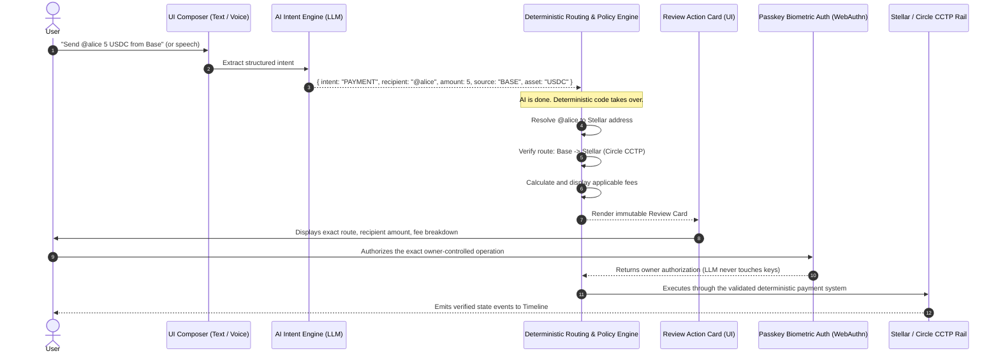

# Page Override: Conversational Composer & Payment Flow

> **Inspiration Source**: **CowryPay** (Talk-to-Pay / AI automation scheme) + **Wise** (Fee transparency & calculation breakdown) + **Family** (Review card & tactile actions) + **Raycast** (Fast action pills).

---

## 1. The CowryPay-Inspired AI Automation Scheme

CowryPay demonstrates the ideal conversation-to-execution pipeline for multi-chain and conversational money movement. Telya formalizes this with strict deterministic boundaries:

---

## 2. Composer UI Specs (Raycast + Family Inspired)

The Composer sits centrally in the viewport (or docked at the bottom on mobile):
- **Input Field**:
  - Placeholder: *"Type or speak what you want to do (e.g. Send @alice 5 USDC)"*
  - Shortcut cue: `[Press ↵ to send]`
- **Voice Button (Press-to-talk)**:
  - Microphone SVG icon with tooltip *"Hold to speak"*.
  - When active: Gentle radial pulse animation (`var(--proof)` aura) + live audio waveform.
  - When released: Instant audio transcription and intent parsing.
- **Quick Action Pills (Raycast Style)**:
  - Horizontal carousel of prompt pills:
    - `"Send 5 USDC to @alice"`
    - `"Check my balances"`
    - `"View active Agent Passes"`
    - `"Add money via MoneyGram"`

---

## 3. The Payment Review Card (Wise + Family Inspired)

Before any money moves, an interactive review card renders in the conversation stream:

### Breakdown Elements (Wise Standard)
1. **Recipient Header**: Recipient avatar, verified badge, `@alice`, and resolved destination network (`Stellar`).
2. **Transfer Line Items**:
   - **Amount to Send**: `5.00 USDC`
   - **Transfer Fee**: Show the calculated fee, or `Sponsored` only when sponsorship is actually configured for that route.
   - **Route Selected**: `Circle CCTP (Base → Stellar)` with explanation tooltip: *"Selected because your funds are on Base and @alice prefers Stellar."*
   - **Recipient Gets**: `5.00 USDC` (highlighted in bold tabular numbers; provider/network costs remain separate).
3. **Action Triggers**:
   - Primary: **"Confirm with Passkey"** (Deep navy button with fingerprint SVG).
   - Secondary: **"Cancel"** (Muted text link).

---

## 4. Ambiguity Resolution (Deterministic Failsafe)

If the intent is ambiguous (e.g. user has funds on both Stellar and Base and says *"Send @bob 10 USDC"*):
- Telya **NEVER** silently guesses.
- An interactive option selector is displayed:
  - Option A: *"Send from Stellar USDC"* with its current fee and timing.
  - Option B: *"Send from Base USDC via Circle CCTP"* with its current fee and provider estimate.
