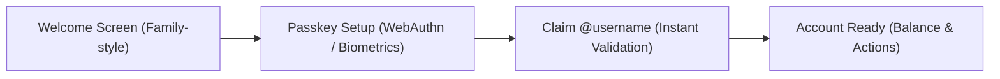

# Page Override: Onboarding & Identity (`@username` + Passkey)

> **Inspiration Source**: **Family Web Onboarding** (passkey simplicity, aesthetic serenity) + **Wise Web Onboarding** (step progression, instant validation) + **Linear** (focused modal speed).

---

## 1. User Journey & Step Progression

The onboarding experience completely removes crypto anxiety (no 24-word seed phrases, no network selection, no gas warnings):



### Step 1: Serene Welcome (`/onboarding`)
- **Visuals**: Centered frosted ceramic card with ambient radial gradient backlight.
- **Copy**: *"Money movement that feels like a conversation."*
- **Primary Action**: Single high-contrast navy CTA: **"Create account with Passkey"** (Family-inspired).
- **Secondary Action**: *"Already have an account? Sign in"*.
- **Sub-copy**: *"Secured by your device's biometric authentication (Face ID / Touch ID / Windows Hello). No seed phrases to lose."*

### Step 2: Passkey Generation (WebAuthn)
- Native biometric prompt triggers directly from browser.
- Under the hood: Derives or pairs credentials with **Stellar Smart Account Kit**.
- Loading indicator: High-precision circular spinner with text: *"Creating your smart account on Stellar..."*

### Step 3: Handle Claiming (`@username`)
- **Inspired by**: Family handle claiming & Wise profile setup.
- Single focused input with prefix `@`:
  - Microcopy: *"Choose your personal handle. Friends and agents use this to send you digital dollars."*
  - Real-time debounced availability check against registry.
  - State indicator:
    - Checking: Subtle pulsing dot.
    - Available: Proof-green checkmark + *"@alex is available"*.
    - Taken: Soft amber banner + *"@alex is taken, try @alex_stl"*.
- Case-insensitivity guarantee: Displayed in lowercase canonical form.

### Step 4: Account Presentation Card
- Presents the freshly minted smart account:
  - User avatar with initials or generative gradient.
  - Verified handle badge: `@username`.
  - Passkey security badge: `"Biometrics Active"`.
  - Network badge: `"Stellar Testnet (Sponsored)"`.
  - Initial balance: `$0.00 USDC`.
  - Quick options: `"Add funds"` or `"Go to conversational home"`.

---

## 2. Component Specifications

### Username Input Field
```css
.handle-input-wrapper {
  position: relative;
  display: flex;
  align-items: center;
  border: 1px solid var(--edge);
  border-radius: var(--radius-sm);
  background: var(--surface-solid);
  padding: 4px 14px;
  transition: all 180ms ease;
}

.handle-input-wrapper:focus-within {
  border-color: var(--navy);
  box-shadow: 0 0 0 3px rgba(17, 26, 74, 0.08);
}

.handle-prefix {
  font-size: 20px;
  font-weight: 600;
  color: var(--muted);
  user-select: none;
}

.handle-input {
  border: none;
  outline: none;
  font-size: 19px;
  font-weight: 600;
  color: var(--heading);
  width: 100%;
  padding: 8px 6px;
}
```

---

## 3. Anti-Patterns to Avoid
- ❌ Asking users to choose between Stellar or Base during initial signup.
- ❌ Displaying raw G-addresses (`GA5Z...`) or contract IDs during onboarding.
- ❌ Forcing multi-page unskippable onboarding tutorials.
