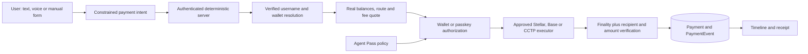

# Telya Buildathon Submission Package

**Status:** Draft — verified Stellar evidence is ready; the integrated browser journey, CCTP routes, independent user test, video format and organizer cutoff are still open.

**Environment:** Testnet only. No transaction or balance in this package represents Mainnet funds.

## What Telya does

Telya turns a payment request into deterministic, verifiable USDC movement. The user sees the resolved recipient, route and fees before authorizing, real persisted stages while money moves, and a receipt only after finality plus recipient and amount verification.

Agent Pass is the secondary differentiator: an agent receives a bounded, expiring and revocable USDC allowance rather than unrestricted wallet access.

## Public entry points

- Application: <https://telya.vercel.app>
- Health: <https://telya.vercel.app/api/health>
- Source: <https://github.com/Alike001/telya>
- Current implementation and blockers: [EXECUTION-TRACKER.md](EXECUTION-TRACKER.md)
- Architecture: [ARCHITECTURE.md](ARCHITECTURE.md)
- Evidence manifest: [EVIDENCE-MANIFEST.md](EVIDENCE-MANIFEST.md)
- Independent tester runbook: [INDEPENDENT-TESTING.md](INDEPENDENT-TESTING.md)

The public URL currently proves the deployed `main` branch only. Features in draft pull requests are not part of the public acceptance claim until their tested commits are deployed.

Live recheck on November 27, 2026 at 03:00 UTC: the health endpoint returned `ready` with application/database `ok`, and Stellar Testnet Horizon returned `successful: true` at the recorded ledger for the direct payment plus all four positive Agent Pass transactions below.

## How to verify without a wallet

1. Open the health endpoint. Expect HTTP `200` with application and database readiness. A healthy response does not prove a payment route.
2. Open the exact Stellar Testnet transaction links in the evidence register below.
3. Confirm that the direct payment transaction is successful and that the account, recipient, amount and ledger match the register.
4. Open the Agent Pass creation, allowed spend, revocation and owner-after-revocation transactions. The rejected overspend and post-revocation attempts intentionally have no transaction hashes.
5. Review the current tracker before testing a draft feature. It distinguishes automated, database, browser and live Testnet evidence.

### Reproduce draft public-network readiness

PR #66 head `42990e3` adds a secret-safe, read-only probe for the infrastructure
used by the integrated draft. After checking out that exact head and configuring
the public Testnet values, run:

```bash
pnpm env:check -- --flow=cctp
pnpm testnet:probe
```

The probe must report Base Sepolia chain `84532`, deployed code for the configured
Base USDC/CCTP contracts, a current Stellar Testnet ledger and discoverable
interfaces for every configured Stellar contract. It prints no environment
values and does not read a wallet balance, sign, submit, attest, mint or verify
payment finality. Passing it is infrastructure readiness—not financial completion.

## Local interactive setup

Requirements: Node.js 22 or newer, pnpm 11, a direct Neon Testnet database URL, and the server-only credentials named in `.env.example` for the flow being exercised.

```bash
pnpm install
pnpm db:migrate
pnpm dev
```

Open `http://localhost:3000`. Do not paste credentials into an issue, PR, recording or browser-visible `NEXT_PUBLIC_*` variable unless `.env.example` explicitly marks the value public.

The full authenticated draft stack additionally needs Privy credentials and localhost WebAuthn settings. Until those are configured and the browser acceptance pass is recorded, use the public evidence register rather than claiming the draft conversational journey works end to end.

## Testnet funding

- Native Stellar Testnet XLM is for account/network operations, not USDC. Stellar's official CLI supports `stellar keys generate alice --network testnet --fund` for a funded Testnet account: <https://developers.stellar.org/>.
- Testnet USDC is separate. Circle's public faucet supports both Stellar Testnet and Base Sepolia and states its current per-address/network limit: <https://faucet.circle.com/>.
- Select the exact Testnet network and verify the destination address before requesting funds. Never send Mainnet assets to a Testnet address.
- A Telya Stellar user wallet is a Smart Account Kit `C...` contract address. Do not assume a faucet or third-party wallet accepts a contract address: verify the destination and resulting on-chain balance first. Use a prepared, already verified Testnet account when direct faucet delivery is incompatible.
- Base Sepolia execution also needs Base Sepolia ETH for gas when the connected wallet, rather than Telya sponsorship, pays gas. Telya must show unavailable/insufficient gas instead of inventing a balance.

## Verified primary fallback: direct Stellar USDC

This is the strongest complete, independently inspectable payment evidence currently available. It is the fallback judge demo until the integrated conversational flow and cross-chain routes pass live acceptance.

| Field | Verified value |
| --- | --- |
| Smart account | [`CC5CEYCUE7KZS3VA7ICX7H5GFKW7KYN4QEO2HDDW2GSW4YWZK7JSWKW3`](https://stellar.expert/explorer/testnet/contract/CC5CEYCUE7KZS3VA7ICX7H5GFKW7KYN4QEO2HDDW2GSW4YWZK7JSWKW3) |
| Intended and verified recipient | [`GAAGLUBSWZQPKLAKJS62BB3PUH6XGBJRML6SPX5XIPM56XFNGTV4XCCW`](https://stellar.expert/explorer/testnet/account/GAAGLUBSWZQPKLAKJS62BB3PUH6XGBJRML6SPX5XIPM56XFNGTV4XCCW) |
| Accepted amount | `0.5 USDC` |
| Transaction | [`3e58eab868ebc75e0f0c8c128c8df779fa6f50e8cd6afd37bf8e6c6dc3db1e1e`](https://stellar.expert/explorer/testnet/tx/3e58eab868ebc75e0f0c8c128c8df779fa6f50e8cd6afd37bf8e6c6dc3db1e1e) |
| Ledger | `5915869` |
| Completion rule | Finality, recipient and amount verified before `completed`; receipt restored after refresh |

## Verified Agent Pass evidence

Smart account: [`CBV3RM6TUXSRPG2ZHVVXNKIGJZKOL2KQWPTOHRZFVHW7DIJGTG5U2QLP`](https://stellar.expert/explorer/testnet/contract/CBV3RM6TUXSRPG2ZHVVXNKIGJZKOL2KQWPTOHRZFVHW7DIJGTG5U2QLP)

| Proof | Result | Evidence |
| --- | --- | --- |
| Create allowance | Successful | [`bb683c78b369e43b2cbb91696cf13eecea086a5fb3d0efd14db3386718524f13`](https://stellar.expert/explorer/testnet/tx/bb683c78b369e43b2cbb91696cf13eecea086a5fb3d0efd14db3386718524f13), ledger `5917312` |
| Spend `0.4 USDC` within allowance | Successful | [`4aa9de4971dc8f300b3a4e326daabeeba74a987c9cc3b6969e137eae4b92ed84`](https://stellar.expert/explorer/testnet/tx/4aa9de4971dc8f300b3a4e326daabeeba74a987c9cc3b6969e137eae4b92ed84), ledger `5917322` |
| Exceed cumulative allowance | Rejected | No transaction and no balance movement; merged acceptance evidence in PR #43 |
| Revoke | Successful | [`82039abc17fbb334551fb218b6e050ba7abc9637f96e8605f4a66671409ea58c`](https://stellar.expert/explorer/testnet/tx/82039abc17fbb334551fb218b6e050ba7abc9637f96e8605f4a66671409ea58c), ledger `5917461` |
| Agent spends after revoke | Rejected | No transaction and no balance movement; merged acceptance evidence in PR #43 |
| Owner spends `0.1 USDC` after revoke | Successful | [`249d59b88bdc9ef57d7a99491dfbb78382abe46a087d9265cb9f0b3b23825e28`](https://stellar.expert/explorer/testnet/tx/249d59b88bdc9ef57d7a99491dfbb78382abe46a087d9265cb9f0b3b23825e28), ledger `5917500` |

## Architecture at a glance



The AI may parse language into a constrained intent. It never holds keys, signs a transaction, chooses execution policy, or marks a payment complete.

## Thirty-second verified fallback script

This can be recorded from the evidence already accepted on `main`.

1. **0–5 seconds:** “Sending digital dollars should not require understanding wallets, gas and settlement mechanics.” Show the Testnet label.
2. **5–13 seconds:** Show the passkey-controlled smart account and the direct `0.5 USDC` receipt with its persisted completion stages.
3. **13–20 seconds:** Open the exact transaction and recipient links. Point out ledger `5915869`, the verified recipient and the accepted amount.
4. **20–26 seconds:** Show the Agent Pass allowance and its successful `0.4 USDC` bounded spend.
5. **26–30 seconds:** Show the over-limit/revoked rejection evidence and owner-after-revocation transaction: “The agent receives an allowance, not the wallet.”

## Preferred integrated script after live acceptance

Do not record this as a working journey until the integrated browser acceptance pass is complete.

1. **0–5 seconds:** State the user problem and show the Testnet badge plus authenticated user.
2. **5–12 seconds:** Enter “Send 5 USDC to @alice.” Show the verified recipient, source/destination, route, fees and exact receive amount.
3. **12–20 seconds:** Authorize with the correct wallet/passkey. Show persisted stages; do not cut from source submission directly to success.
4. **20–26 seconds:** Open the receipt and explorer evidence. Point out finality, actual recipient and actual amount.
5. **26–30 seconds:** Show a bounded Agent Pass and a rejected over-limit or revoked attempt.

## Recording and pitch checklist

- [ ] Organizer-confirmed deadline, timezone, video duration, format and required links are recorded in `product/DECISIONS.md`.
- [ ] The recorded deployment URL and tested Git commit are shown.
- [ ] Testnet is visible throughout; no Mainnet or production-payout claim is made.
- [ ] No secret, token, database URL, private key, recovery material or personal notification is visible.
- [ ] Every balance, quote, fee, connection and transaction state comes from the real provider/chain path.
- [ ] Source submission is not edited to look like destination completion.
- [ ] Receipt shows exact real hashes, recipient, amount and finality evidence.
- [ ] Refresh/recovery and one truthful failure path are captured.
- [ ] Agent Pass shows limit/expiry, successful bounded spend, rejection and revocation evidence.
- [ ] Captions and narration match what the application actually proves.
- [ ] Final video and public links work in a signed-out browser.
- [ ] An unfamiliar tester completed [the independent runbook](INDEPENDENT-TESTING.md); findings, fixes and retest evidence are recorded.

## Known limitations and blockers

- The current public `main` deployment does not contain the unmerged integrated frontend stack.
- Privy credentials and a real browser wallet/passkey acceptance session are still required for onboarding, contacts, conversational payment, timeline and current Agent Pass UI proof.
- Base direct and both CCTP directions have extensive automated/database safeguards but no accepted signed end-to-end Testnet settlement evidence. They must not appear as completed in the demo.
- The public Base/Stellar endpoints and configured CCTP contracts pass the draft read-only probe, but this does not establish a funded or authenticated wallet, source burn, attestation, destination mint or finality.
- MoneyGram is unavailable pending partner sandbox access and written Smart Account Kit contract-wallet compatibility confirmation.
- Independent unfamiliar-user testing has not yet been recorded.
- The organizer has not yet confirmed the exact cutoff/timezone, artifacts or video format. No duration is inferred here.
- New Vercel deployments are temporarily rate-limited, and fork preview checks require Vercel GitHub authorization.

## Mainnet roadmap

Telya is not Mainnet-ready and this Buildathon package requests no Mainnet
wallet action. A Mainnet release is gated on all of the following rather than a
network-variable switch:

1. Independent security review of the smart-account rules, relayer boundaries,
   payment state machine, database migrations and browser authorization paths,
   with every material finding fixed and retested.
2. Fresh production deployments and verification of the Stellar account WASM,
   WebAuthn/Ed25519 verifiers, spending-limit policy and USDC contracts. No
   Testnet address, passphrase, sponsor or transaction evidence may be reused.
3. Official Circle Mainnet CCTP domains/contracts, fee behavior, attestation and
   both-direction destination verification tested with controlled limits before
   public availability.
4. Production Privy, RPC, database, sponsor and monitoring configuration with
   least-privilege access, secret rotation, alerting, reconciliation and a
   documented incident/rollback procedure.
5. Risk controls including per-user/route limits, rate limits, insufficient-fund
   handling, duplicate/restart recovery and operational review of stuck funds.
6. MoneyGram only after written provider approval, production credentials,
   compliance requirements and Smart Account Kit contract-wallet compatibility.
7. A separate independent-user acceptance pass on the exact production commit,
   followed by staged launch limits. Testnet evidence in this package remains
   historical evidence and never proves Mainnet settlement.

## Final submission gate

The package is ready only when the tested deployment commit, integrated browser walkthrough, required live route evidence, independent test findings and fixes, organizer requirements, final video, public links and submission confirmation are recorded. Until then, this document is a truthful preparation package—not a completion claim.
